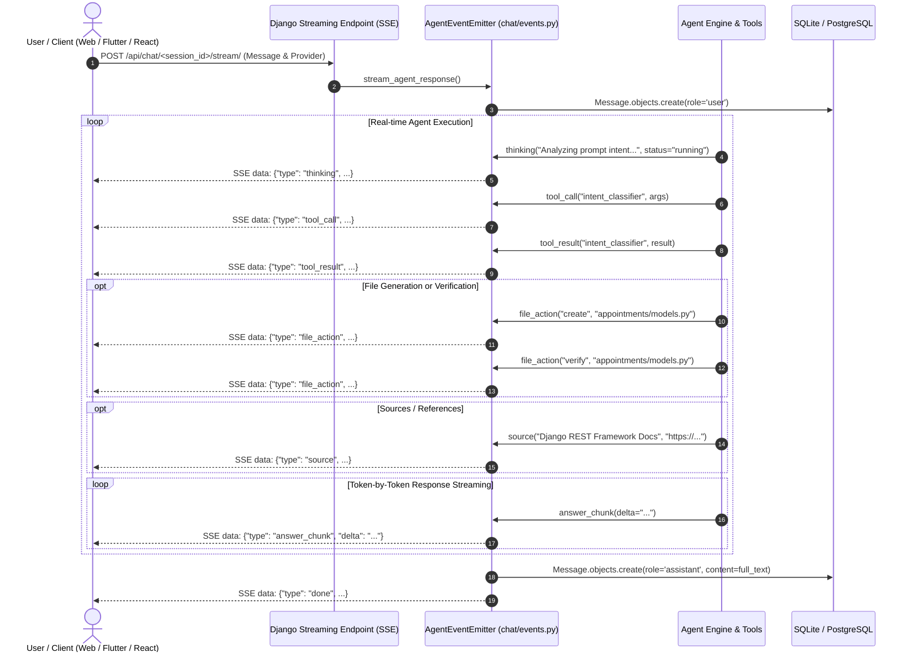

# DevDialogue AI — Live Agent Activity Feed & Streaming Architecture

This document specifies the real-time event streaming architecture and structured event schema for DevDialogue AI's **Live Agent Activity Feed** (similar to Claude / ChatGPT reasoning traces).

---

## 1. High-Level Architecture



---

## 2. Event Schema Specification

All events are formatted in standard **Server-Sent Events (SSE)** protocol lines:
```http
Content-Type: text/event-stream
Cache-Control: no-cache, no-transform
X-Accel-Buffering: no

data: {"type": "thinking", ...}\n\n
```

### Event Types & JSON Payloads

#### 1. `thinking`
Represents the agent's internal reasoning or milestone progress.
```json
{
  "type": "thinking",
  "id": "step_intent",
  "title": "Analyzing prompt and requirement context",
  "content": "Detecting intent, technical constraints, and conversation progress...",
  "status": "running", // "running" | "completed" | "cancelled"
  "timestamp": 1731805000.123
}
```

#### 2. `tool_call`
Emitted when the agent invokes an internal tool, web search, or analyzer.
```json
{
  "type": "tool_call",
  "id": "tool_intent",
  "tool": "intent_classifier",
  "args": {
    "prompt_length": 34,
    "session_mode": "mode1",
    "session_status": "interviewing"
  },
  "summary": "Evaluating technical completeness rubric and elicitation status",
  "timestamp": 1731805000.456
}
```

#### 3. `tool_result`
Emitted when a tool finishes execution.
```json
{
  "type": "tool_result",
  "id": "tool_intent",
  "tool": "intent_classifier",
  "result": {
    "has_summary": false,
    "is_approval": false,
    "is_direct_code_demand": false
  },
  "duration_ms": 65,
  "status": "success", // "success" | "error"
  "timestamp": 1731805000.521
}
```

#### 4. `file_action`
Emitted for file operations (reading context, creating code, applying edits, or running static AST checks).
```json
{
  "type": "file_action",
  "action": "create", // "read" | "create" | "edit" | "verify"
  "path": "appointments/models.py",
  "summary": "Synthesized 48 lines (v1)",
  "version": 1,
  "timestamp": 1731805001.012
}
```

#### 5. `source`
References, web documents, or specifications cited during generation.
```json
{
  "type": "source",
  "title": "Workspace: appointments/models.py",
  "url_or_path": "appointments/models.py",
  "kind": "file", // "file" | "web" | "spec"
  "timestamp": 1731805001.100
}
```

#### 6. `answer_chunk`
Streams final assistant answer text or markdown delta token-by-token.
```json
{
  "type": "answer_chunk",
  "delta": "I have created the appointment booking models.",
  "timestamp": 1731805001.200
}
```

#### 7. `error`
Emitted when an unrecoverable error occurs in a step.
```json
{
  "type": "error",
  "message": "AI model quota exceeded.",
  "code": "quota_exceeded",
  "timestamp": 1731805001.250
}
```

#### 8. `done`
Emitted once the entire stream is successfully finalized.
```json
{
  "type": "done",
  "status": "succeeded", // "succeeded" | "failed" | "cancelled"
  "total_duration_ms": 1840,
  "tokens_used": 342,
  "session_status": "srs_ready",
  "completeness_score": 65,
  "rubric_cats": { "core_features": "covered", "tech_stack": "covered" },
  "codes": [{ "id": 12, "module_name": "appointments/models.py" }],
  "title": "Clinic Booking API",
  "timestamp": 1731805001.840
}
```

---

## 3. How to Add New Tools to the Agent Loop

To add a new tool (e.g., `web_search` or `database_migrator`):

```python
from chat.events import AgentEvent, format_sse
import time

def execute_web_search(query: str):
    call_id = f"search_{int(time.time() * 1000)}"
    
    # 1. Emit Tool Call
    yield format_sse(AgentEvent.tool_call(
        call_id=call_id,
        tool="web_search",
        args={"query": query},
        summary=f"Searching web for: {query}"
    ))
    
    start = time.time()
    # Execute actual search...
    results = [{"title": "Django Docs", "url": "https://docs.djangoproject.com"}]
    dur = int((time.time() - start) * 1000)
    
    # 2. Emit Tool Result
    yield format_sse(AgentEvent.tool_result(
        call_id=call_id,
        tool="web_search",
        result=results,
        duration_ms=dur,
        status="success"
    ))
    
    # 3. Emit Sources for Clickable UI Badges
    for item in results:
        yield format_sse(AgentEvent.source(
            title=item["title"],
            url_or_path=item["url"],
            kind="web"
        ))
```

---

## 4. Client Implementation Guides

### A. React Implementation (Hook & Component)

```tsx
import React, { useState } from 'react';

export interface TimelineStep {
  id: string;
  type: string;
  title: string;
  status: 'running' | 'completed' | 'cancelled';
  detail?: string;
  path?: string;
  action?: string;
}

export function useAgentStream(sessionId: number, csrfToken: string) {
  const [steps, setSteps] = useState<TimelineStep[]>([]);
  const [answer, setAnswer] = useState('');
  const [isGenerating, setIsGenerating] = useState(false);
  const [elapsed, setElapsed] = useState('0.0s');

  const sendMessage = async (message: string) => {
    setIsGenerating(true);
    setSteps([]);
    setAnswer('');
    
    const startTs = Date.now();
    const timer = setInterval(() => {
      setElapsed(((Date.now() - startTs) / 1000).toFixed(1) + 's');
    }, 100);

    try {
      const response = await fetch(`/api/chat/${sessionId}/stream/`, {
        method: 'POST',
        headers: { 'Content-Type': 'application/json', 'X-CSRFToken': csrfToken },
        body: JSON.stringify({ message })
      });

      const reader = response.body!.getReader();
      const decoder = new TextDecoder();
      let buffer = '';

      while (true) {
        const { done, value } = await reader.read();
        if (done) break;

        buffer += decoder.decode(value, { stream: true });
        const lines = buffer.split('\n');
        buffer = lines.pop() || '';

        for (const line of lines) {
          if (!line.startsWith('data: ')) continue;
          const ev = JSON.parse(line.slice(6));

          if (ev.type === 'thinking') {
            setSteps(prev => {
              const idx = prev.findIndex(s => s.id === ev.id);
              if (idx >= 0) {
                const next = [...prev];
                next[idx] = { ...next[idx], status: ev.status, title: ev.title, detail: ev.content };
                return next;
              }
              return [...prev, { id: ev.id, type: 'thinking', title: ev.title, status: ev.status, detail: ev.content }];
            });
          } else if (ev.type === 'file_action') {
            setSteps(prev => [...prev, {
              id: `file_${ev.path}`,
              type: 'file_action',
              title: `${ev.action.toUpperCase()} ${ev.path}`,
              status: 'completed',
              path: ev.path,
              action: ev.action,
              detail: ev.summary
            }]);
          } else if (ev.type === 'answer_chunk') {
            setAnswer(prev => prev + ev.delta);
          } else if (ev.type === 'done') {
            clearInterval(timer);
            setIsGenerating(false);
          }
        }
      }
    } finally {
      clearInterval(timer);
      setIsGenerating(false);
    }
  };

  return { sendMessage, steps, answer, isGenerating, elapsed };
}

export function AgentActivityFeed({ steps, isGenerating, elapsed }: { steps: TimelineStep[], isGenerating: boolean, elapsed: string }) {
  const [collapsed, setCollapsed] = useState(false);

  return (
    <div className={`agent-activity-feed ${isGenerating ? 'is-running' : ''} ${collapsed ? 'collapsed' : ''}`}>
      <div className="activity-feed-header" onClick={() => setCollapsed(!collapsed)}>
        <div className="activity-header-left">
          <span className={`activity-status-icon ${isGenerating ? 'spinner' : 'completed'}`}>
            {!isGenerating && '✓'}
          </span>
          <span>Reasoning & Tools</span>
          <span className="activity-step-count">({steps.length} steps)</span>
        </div>
        <div className="activity-header-right">
          <span className="activity-elapsed-badge">⏱️ {elapsed}</span>
          <span className="activity-chevron">{collapsed ? '▶' : '▼'}</span>
        </div>
      </div>
      {!collapsed && (
        <div className="activity-timeline">
          {steps.map(step => (
            <div key={step.id} className={`activity-step ${step.status}`}>
              <div className={`step-icon ${step.status}`}>
                {step.status === 'running' ? '⏳' : '✓'}
              </div>
              <div className="step-content">
                <div className="step-title">{step.title}</div>
                {step.detail && <div className="step-detail">{step.detail}</div>}
              </div>
            </div>
          ))}
        </div>
      )}
    </div>
  );
}
```

---

### B. Flutter Implementation (StreamController & Widget)

```dart
import 'dart:async';
import 'dart:convert';
import 'package:flutter/material.dart';
import 'package:http/http.dart' as http;

class AgentStep {
  final String id;
  final String title;
  final String? detail;
  final String status; // 'running' | 'completed'

  AgentStep({required this.id, required this.title, this.detail, required this.status});
}

class AgentStreamService {
  final http.Client client = http.Client();

  Stream<Map<String, dynamic>> streamChat(String url, Map<String, dynamic> body, String csrfToken) async* {
    final request = http.Request('POST', Uri.parse(url));
    request.headers['Content-Type'] = 'application/json';
    request.headers['X-CSRFToken'] = csrfToken;
    request.body = jsonEncode(body);

    final response = await client.send(request);
    String buffer = '';

    await for (final chunk in response.stream.transform(utf8.decoder)) {
      buffer += chunk;
      final lines = buffer.split('\n');
      buffer = lines.removeLast();

      for (final line in lines) {
        final trimmed = line.trim();
        if (trimmed.startsWith('data: ')) {
          final jsonStr = trimmed.substring(6);
          try {
            yield jsonDecode(jsonStr);
          } catch (_) {}
        }
      }
    }
  }
}

class AgentActivityFeedWidget extends StatelessWidget {
  final List<AgentStep> steps;
  final bool isGenerating;
  final String elapsed;

  const AgentActivityFeedWidget({
    Key? key,
    required this.steps,
    required this.isGenerating,
    required this.elapsed,
  }) : super(key: key);

  @override
  Widget build(BuildContext context) {
    return Container(
      margin: const EdgeInsets.symmetric(vertical: 8),
      decoration: BoxDecoration(
        color: const Color(0xFFF8FAFC),
        borderRadius: BorderRadius.circular(10),
        border: Border.all(color: const Color(0xFFE2E8F0)),
      ),
      child: Column(
        crossAxisAlignment: CrossAxisAlignment.start,
        children: [
          Padding(
            padding: const EdgeInsets.all(10),
            child: Row(
              children: [
                if (isGenerating)
                  const SizedBox(width: 14, height: 14, child: CircularProgressIndicator(strokeWidth: 2))
                else
                  const Icon(Icons.check_circle, color: Colors.green, size: 16),
                const SizedBox(width: 8),
                Text('Reasoning (${steps.length} steps)', style: const TextStyle(fontWeight: FontWeight.bold, fontSize: 13)),
                const Spacer(),
                Text('⏱️ $elapsed', style: const TextStyle(fontSize: 12, color: Colors.blueAccent)),
              ],
            ),
          ),
          const Divider(height: 1),
          ListView.builder(
            shrinkWrap: true,
            physics: const NeverScrollableScrollPhysics(),
            itemCount: steps.length,
            itemBuilder: (context, idx) {
              final s = steps[idx];
              return ListTile(
                dense: true,
                leading: s.status == 'running'
                    ? const SizedBox(width: 12, height: 12, child: CircularProgressIndicator(strokeWidth: 2))
                    : const Icon(Icons.check, color: Colors.green, size: 14),
                title: Text(s.title, style: const TextStyle(fontSize: 12, fontWeight: FontWeight.w600)),
                subtitle: s.detail != null ? Text(s.detail!, style: const TextStyle(fontSize: 11)) : null,
              );
            },
          ),
        ],
      ),
    );
  }
}
```
